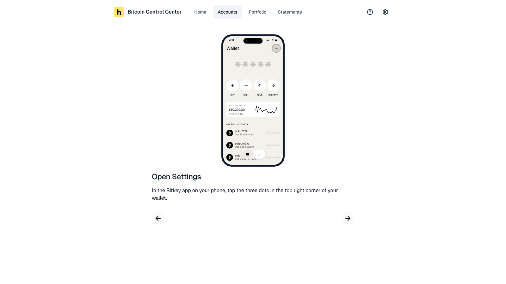

Control Center tracks a Bitkey from the wallet descriptor you export in the Bitkey app. It's watch-only. Nothing can be spent.

<Note>A Bitkey connects as **Unverified**. Bitkey doesn't support proving ownership of its keys, so Control Center can't verify the wallet is yours. Its balance and history update as usual, but statements leave it out.</Note>

## What you need

- Your phone with the Bitkey app.
- A way to copy text on your phone and paste it into Control Center.

## Connect a Bitkey

<Steps>
  <Step title="Start">
    Select **Add Account** → **Bitkey**. Read **Connect Your Bitkey**. Select **Next**.
  </Step>
  <Step title="Export from the Bitkey app">
    Control Center walks you through it on a picture of the app:

    1. **Open Settings:** tap the three dots in the top right corner of your wallet.
    2. **Go to Exports:** under **Advanced**, tap **Exports**.
    3. **Choose Your Wallet Descriptor:** tap **Current wallet descriptor**. Bitkey calls it an XPUB bundle. It holds public keys only.
    4. **Send It to This Device:** tap **Download XPUB bundle**, then copy the text.

    <Frame caption="Control Center shows each step in the Bitkey app.">
      
    </Frame>

    <Warning>Don't email the descriptor to yourself. Email keeps copies on mail servers, and the descriptor reveals every address and transaction in your wallet.</Warning>
  </Step>
  <Step title="Paste the descriptor">
    On **Add Your Wallet Descriptor**, paste the whole text into **Wallet descriptor**. Select **Next**.

    Paste the full export. It has an `External:` line and an `Internal:` line. There's no file upload.
  </Step>
  <Step title="Check and add">
    **We Found Your Bitkey** lists its three keys. Enter a **Name**. Select **Add Bitkey**.

    You see **Bitkey Connected!** and your balance. Select **View Bitkey** or **Connect Another Account**.
  </Step>
</Steps>

Delete any other copy of the descriptor once it's added. Control Center stores it on your device and never shares it.

## On the account page

A Bitkey shows its three keys:

| Key | Where it lives |
| --- | --- |
| **Phone key** | In the Bitkey app on your phone |
| **Hardware key** | On your Bitkey, unlocked by your fingerprint |
| **Block key** | Held by Block, to help you recover if you lose your phone or Bitkey |

Select a key to see its public key and derivation path.

A Bitkey counts in your totals on **Home** and **Portfolio**. It isn't offered when you set up a multisig wallet.

## Recovered your Bitkey?

A Bitkey recovery moves your Bitcoin to new keys. The old account stops updating. Export the wallet descriptor again and add it as a new Bitkey. You can then [archive](/bitcoin-control-center/accounts/manage-accounts#archive-a-wallet) the old one.

## If something goes wrong

| Message | What to do |
| --- | --- |
| "This Bitkey is already connected" | It's already tracked. Control Center opens it. |
| "This Bitkey is archived" | Restore it from **Archived** on **Accounts**. |
| "This doesn't look like a Bitkey wallet descriptor" | Paste everything the Bitkey app exported. |
| "Paste everything the Bitkey app exported" | You pasted part of it. Paste both the `External:` and the `Internal:` line. |
| "The External and Internal descriptors don't match" | Export the descriptor again and paste all of it. |
| "Bitkey wallets are 2-of-3 multisig, but this descriptor describes a different wallet" | You pasted another wallet's descriptor. Export it from the Bitkey app. |
| "This descriptor is for a test network" | Control Center tracks mainnet Bitcoin only. |
