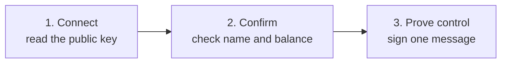

Control Center imports **public** keys (xpubs) only. Your coins stay on your wallet. Nothing can be spent.

## What you need

| Wallet | Connects by | You also need | Address types |
| --- | --- | --- | --- |
| **Ledger** | USB | The **Bitcoin** app open. In a browser: Chrome, Brave, or Edge. | Legacy, Nested SegWit, Native SegWit, Taproot |
| **Trezor** | Trezor Suite | Trezor Suite (desktop or web). Pop-ups allowed. | Legacy, Nested SegWit, Native SegWit. No Taproot. |
| **COLDCARD** Mk2, Mk3, Mk4 | MicroSD file | A MicroSD card. USB is not supported. | Legacy, Nested SegWit, Native SegWit |
| **COLDCARD Q** | QR code | A webcam. | Legacy, Nested SegWit, Native SegWit |
| **Keystone** | QR code | A webcam. | Native SegWit |

Other wallet or address type? Use an [xpub or descriptor](/bitcoin-control-center/accounts/xpub-and-descriptors) instead.

<Warning>Wallet scans only list accounts with a balance above zero. A new or emptied wallet shows "No wallets found". To track it anyway, add it by [xpub or descriptor](/bitcoin-control-center/accounts/xpub-and-descriptors).</Warning>

## Add a hardware wallet

Every wallet follows the same three stages.

1. Select **Add Account**. Pick your wallet.

   <Frame caption="Pick your wallet.">
     
   </Frame>

2. Follow the steps for your wallet below.
3. Check the account and balance. Select **Yes, Continue**. The account is saved as **pending**.
4. Sign the message on your device. The account becomes **verified**. See [Verify ownership](/bitcoin-control-center/accounts/verify-ownership).

<Tabs>
  <Tab title="Ledger">
    1. Plug in by USB. Unlock with your PIN. Open the **Bitcoin** app.
    2. Select **Next**. In a browser, allow the connection prompt.
    3. Control Center scans for accounts. Pick one if it finds several.

    <Frame caption="Connect your Ledger.">
      
    </Frame>

    **Names:** accounts are named like Ledger Live, such as "Bitcoin Native Segwit 1". "Segwit" alone means Nested SegWit.

    **Scan rule:** Control Center checks account 1 of each address type. It checks account 2 only if account 1 has a balance, and so on. An account after an empty one is not found. Add it by [xpub](/bitcoin-control-center/accounts/xpub-and-descriptors) instead.

    <Note>On the desktop app, close Ledger Live and other wallet apps first. Only one app can talk to the Ledger at a time.</Note>
  </Tab>
  <Tab title="Trezor">
    1. Plug in. Unlock.
    2. Select **Next**. Trezor Suite opens. Allow Control Center to read your device details.
    3. Select **Next**. Choose the account in Trezor Suite. Come back to Control Center.

    <Frame caption="Connect your Trezor.">
      
    </Frame>

    - Control Center uses Trezor Suite desktop if it is running. Otherwise it opens Trezor Suite Web in a pop-up. Allow pop-ups for Control Center.
    - Taproot accounts are not offered. Trezor cannot sign the ownership message for them.
    - The confirm screen always says "Account 1". It still uses the account you picked.
  </Tab>
  <Tab title="COLDCARD">
    1. Pick your model: **MK2/MK3**, **MK4**, or **Q**.

       <Frame caption="Pick your COLDCARD model.">
         
       </Frame>

    2. On Mk2–Mk4, choose **By Airgapping**. USB is not supported.
    3. On the COLDCARD, go to **Advanced/Tools** → **Export Wallet** → **Generic JSON**. If asked for an account number, choose yours (usually `0`).
    4. Upload `coldcard-export.json`. Select **Connect Wallet**.

    <Frame caption="Export Generic JSON to the MicroSD card.">
      
    </Frame>

    On **COLDCARD Q**, show the same export as a QR code (press the QR button). Hold the screen up to your webcam.

    <Frame caption="MicroSD or QR.">
      
    </Frame>

    <Tip>Delete the export file from your computer when you finish. It holds your public keys.</Tip>
  </Tab>
  <Tab title="Keystone">
    1. Select **Next**. Allow camera access when your browser asks.
    2. On Keystone, show your wallet's export QR code. Select **Ready to Scan**.
    3. Hold the Keystone screen up to your webcam.

    <Frame caption="Scan the Keystone QR.">
      
    </Frame>

    Keystone accounts are treated as Native SegWit (`bc1q…`). If the balance looks wrong, add the wallet by [descriptor](/bitcoin-control-center/accounts/xpub-and-descriptors) with the right address type.
  </Tab>
</Tabs>

## After you add it

The new account syncs. Large wallets take longer.

<Frame caption="Syncing a new account.">
  
</Frame>

- Balance looks wrong? See [Troubleshooting](/bitcoin-control-center/help/troubleshooting#balances).
- Stopped before signing? The account stays **pending**. Open it and select **Continue**.
- To rename, archive, or remove it, see [Manage accounts](/bitcoin-control-center/accounts/manage-accounts).

<Warning>Never type your seed phrase into Control Center. Approve signatures on the device only.</Warning>
