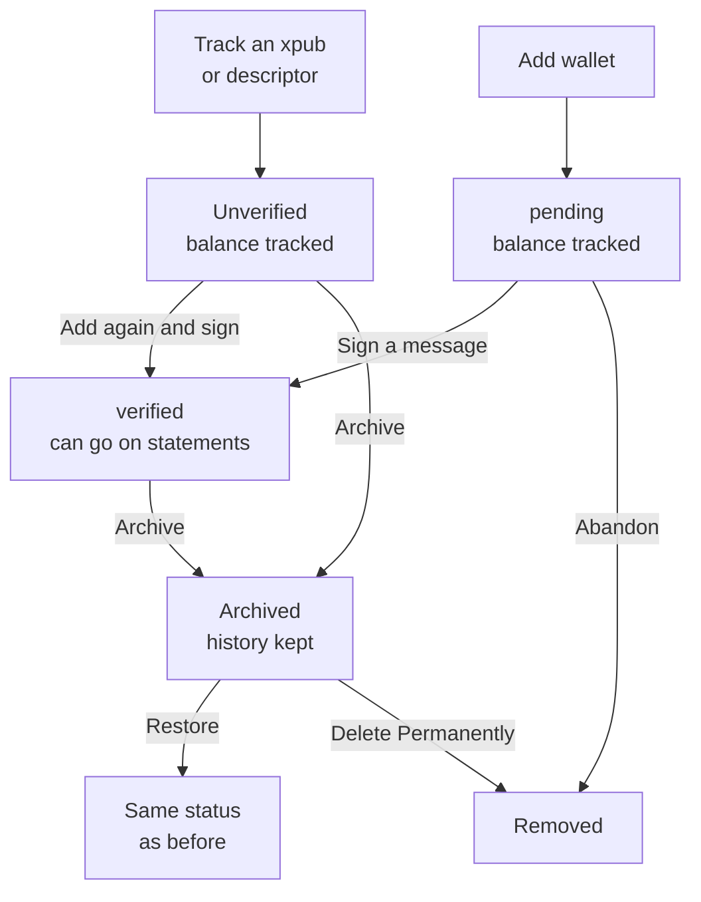

An **account** is anything Control Center tracks: a wallet, an exchange, or a holding you enter by hand.

<Note>Some screens say **claim**. A claim is the same thing as a wallet account.</Note>

## Three kinds of account

| Kind | Examples | How the balance is read | Can go on a statement |
| --- | --- | --- | --- |
| **Self-custody wallet** | [Ledger, Trezor, COLDCARD, Keystone](/bitcoin-control-center/accounts/hardware-wallets), [Bitkey](/bitcoin-control-center/accounts/bitkey), [multisig](/bitcoin-control-center/accounts/multisig), [xpub or descriptor](/bitcoin-control-center/accounts/xpub-and-descriptors) | Your Electrum server, from public keys | Yes, once verified |
| **Exchange** | [Coinbase, Kraken, Robinhood, Strike](/bitcoin-control-center/accounts/exchanges) | The exchange, with a read-only API key | No |
| **Manual** | [Manual Bitcoin, Bitcoin ETFs](/bitcoin-control-center/accounts/manual-and-etfs) | The numbers you enter | No |

All three count toward your totals on Home and Portfolio.

## Statuses

Each account card shows a badge.

| Badge | Meaning | What to do |
| --- | --- | --- |
| **Verified** | You proved control of this wallet. | Nothing. It can go on a statement. |
| **Pending** | Wallet added, but not yet verified. Its balance is still tracked. | Open it. Select **Continue** to [verify](/bitcoin-control-center/accounts/verify-ownership). For multisig, pick a signing device. |
| **Connected** | Exchange key works. | Nothing. |
| **Reconnect** | Exchange key expired or cannot be read. Balance shows "—" and is left out of totals. | Open it. Select **Reconnect Account**. |
| **Unverified** | A wallet you track without proving you own it, such as a [tracked xpub](/bitcoin-control-center/accounts/xpub-and-descriptors) or a [Bitkey](/bitcoin-control-center/accounts/bitkey). Manual and ETF holdings show it too. Its balance is still tracked. | Nothing. To put a wallet on a statement, [verify it](#verify-a-tracked-wallet-later). |

## The life of a wallet account

You only need to verify a wallet for statements. If you just want to watch its balance, [track it by xpub or descriptor](/bitcoin-control-center/accounts/xpub-and-descriptors#track-a-wallet). It shows as **Unverified**.

The **Accounts** summary counts each status, for example **2 Pending** and **1 Unverified**. Unverified wallets don't count as pending.

### Verify a tracked wallet later

Add the same wallet again with your device, **Multisig**, or **Manually Sign**. Control Center opens the account you already have and asks you to sign. Once you sign, it becomes **verified**. It does not create a duplicate.

A [Bitkey](/bitcoin-control-center/accounts/bitkey) can't be verified. It stays **Unverified**.

## How balances update

- **Wallets:** read from your Electrum server. Only **confirmed** transactions count. Incoming Bitcoin appears after its first confirmation.
- **Exchanges:** refreshed when you open **Accounts** or **Portfolio** (at most once a minute), and in the background.
- **Manual and ETF:** change only when you edit them. ETF values drift slightly each day to reflect fund fees.
- **History:** Control Center saves a balance snapshot for every account about every 15 minutes while it runs.

<Tip>History is only recorded while Control Center is running. On desktop, leave it running in the tray to keep history complete. Wallet history before you added the account is rebuilt from the blockchain when you need it.</Tip>

## Account limits to know

- **Mainnet only** for hardware wallets and multisig.
- **Wallet scans hide empty accounts.** Ledger, COLDCARD, and Keystone only list accounts with a balance above zero. To track an empty wallet, use an [xpub or descriptor](/bitcoin-control-center/accounts/xpub-and-descriptors).
- **Exchange keys expire after one year.** Reconnect with a fresh key.

Next: [manage your accounts](/bitcoin-control-center/accounts/manage-accounts).
