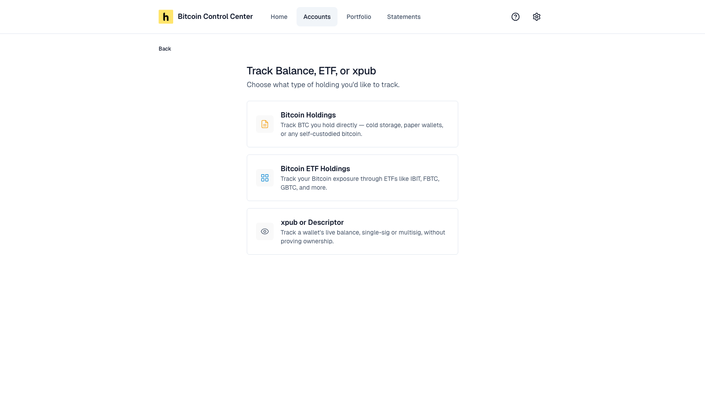
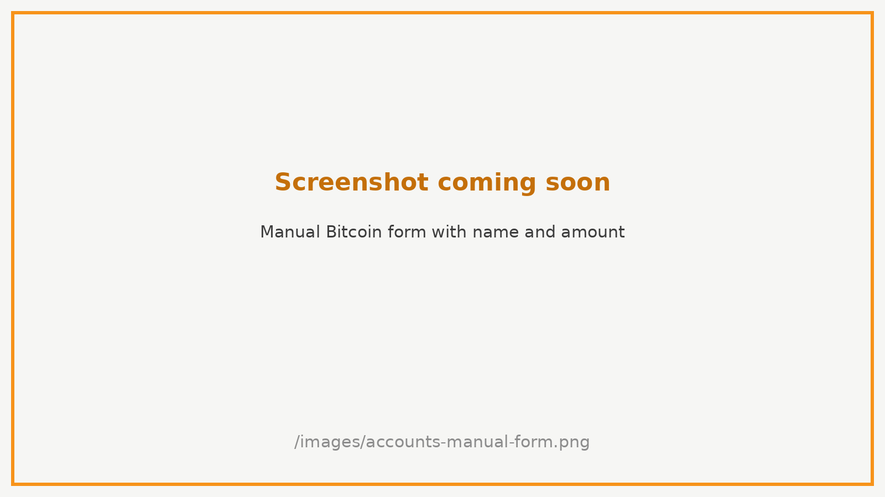
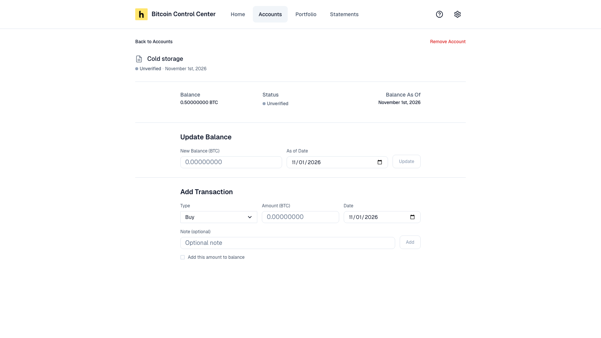
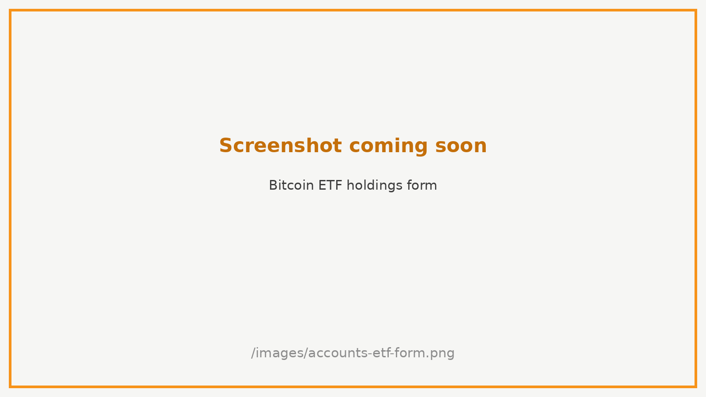
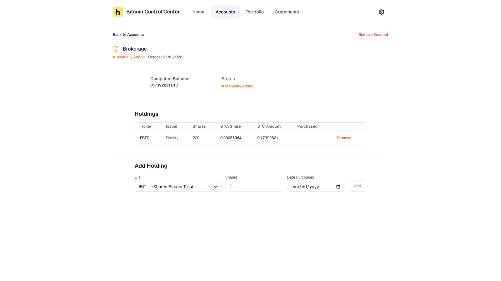
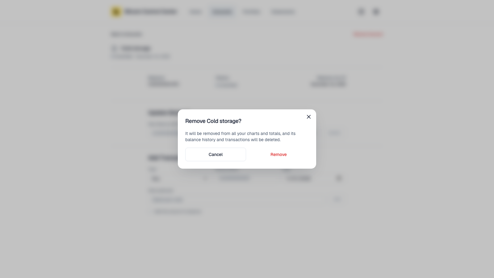

Use these for Bitcoin you can't connect, and for Bitcoin ETF shares. You keep them up to date yourself.

1. Select **Add Account** → **Track Balance, ETF, or xpub**.
2. Pick **Bitcoin Holdings** or **Bitcoin ETF Holdings**.

<Frame caption="Pick a holding type.">
  
</Frame>

The third choice, **xpub or Descriptor**, tracks a wallet's live balance. See [Track a wallet](/bitcoin-control-center/accounts/xpub-and-descriptors#track-a-wallet).

<Note>Manual and ETF holdings count in your totals. They show as **Unverified** and can't go on a statement, because there is nothing to verify.</Note>

## Manual Bitcoin

For cold storage, paper wallets, or Bitcoin held elsewhere.

1. Enter a **Display Name** and **Balance (BTC)**.
2. Set the **As of Date**. It defaults to today. The **Portfolio** chart starts the holding on this date.
3. Select **Add Holding**. You see **Holdings Added!** Select **View Holdings** or **Connect Another Account**.

<Frame caption="Name and amount.">
  
</Frame>

<Tip>Have the wallet's xpub? [Add it by xpub](/bitcoin-control-center/accounts/xpub-and-descriptors) instead. Control Center then tracks the balance for you.</Tip>

### Keep it current

Open the holding from **Accounts**.

<Frame caption="Update the balance, or log a transaction.">
  
</Frame>

- **Update Balance:** enter the new total and its date. Select **Update**. The chart changes from that date.
- **Add Transaction:** log a **Buy**, **Sell**, **Transfer In**, or **Transfer Out**. Check **Add this amount to balance** to change the balance too.

Things to know:

- A **Sell** or **Transfer Out** can't take the balance below zero. Update the balance first if needed.
- **Deleting a transaction always reverses it** in the balance, even if you didn't check **Add this amount to balance**.
- A back-dated transaction changes the chart from its own date. So does deleting it.
- Deleting a transaction has no confirmation.

## Bitcoin ETFs

1. Enter a **Display Name**, such as your brokerage.
2. For each fund, pick the **ETF** and enter **Shares**. **Date Purchased** is optional.
3. Select **+ Add Another ETF** for more funds.
4. Select **Add ETF Holdings**. You see **ETF Holdings Added!** Select **View Holdings** or **Connect Another Account**.

<Frame caption="ETF holdings with an estimated BTC total.">
  
</Frame>

Supported funds: IBIT, FBTC, GBTC, ARKB, BITB, HODL, BTC (Grayscale Mini Trust), and MSBT.

### How the BTC amount is worked out

Shares × Bitcoin per share. Bitcoin per share is a fixed reference figure for each fund. It goes down a little each day to reflect the fund's fees.

<Info>This is an **estimate**. It is not live fund data. Your broker's figure may differ slightly.</Info>

### Change your holdings

Open the ETF account. Under **Holdings**, select **Add Holding** or **Remove**. To change a share count, remove the row and add it again.

<Frame caption="An ETF account and its holdings.">
  
</Frame>

## Removing a holding

Open the holding. Select **Remove Account**.

- **Manual Bitcoin:** Control Center asks first. Select **Remove** to confirm.
- **ETF:** the account is removed **immediately**, with no confirmation.

<Frame caption="Removing a manual holding asks first.">
  
</Frame>

<Warning>Removing deletes the account, its balance history, and its transactions. There is no undo.</Warning>

Manual and ETF accounts can't be renamed yet. To rename one, remove it and add it again.
