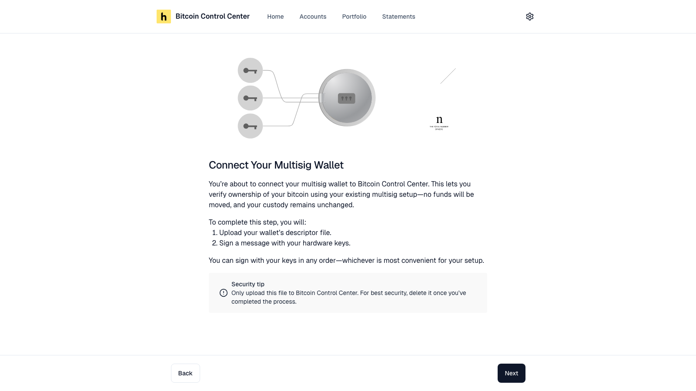
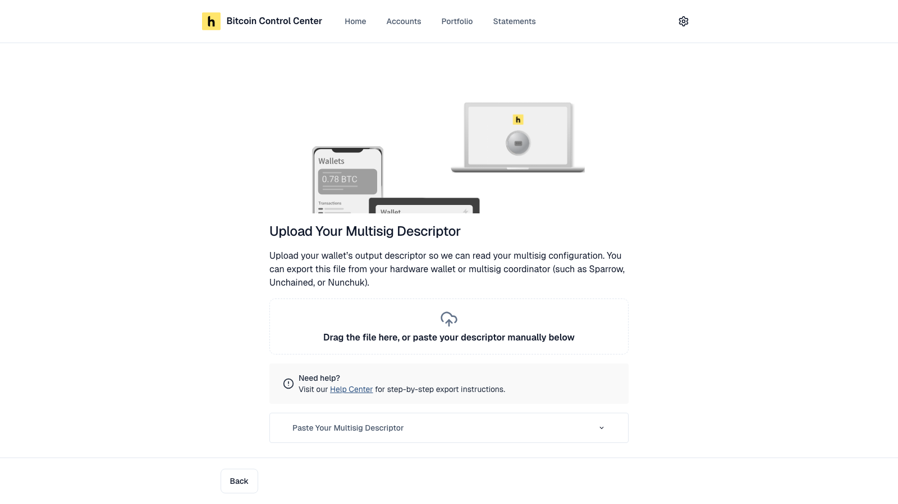

Track a multisig wallet from its **descriptor**. No funds move. Your custody does not change.

<Tip>Only want to watch the balance? You don't need any signing devices. Select **Add Account** → **Track Balance, ETF, or xpub** → **xpub or Descriptor** and paste the descriptor. The wallet shows as **Unverified** and stays off statements. See [Track a wallet](/bitcoin-control-center/accounts/xpub-and-descriptors#track-a-wallet).</Tip>

## What you need

- Your wallet's descriptor file, or the descriptor text.
- Enough signing devices to meet your quorum. A 2-of-3 wallet needs 2 keys.
- Supported signing devices: Ledger, Trezor, COLDCARD, Keystone.

### Why only these devices

Most wallets can't yet sign a message for a multisig address. The standard for that is called BIP-322.

So Control Center verifies multisig its own way. Each key signs the message separately, from its own single-key address. Control Center then checks that each signing key belongs to your multisig wallet.

This only works with devices Control Center can connect to directly: Ledger, Trezor, COLDCARD, and Keystone. We're working to add more.

<Note>A key held in another device or app can still be part of your wallet. You just need enough supported devices among your keys to meet your quorum.</Note>

### Where to get the descriptor

Control Center reads these formats:

| Format | Comes from |
| --- | --- |
| A single descriptor line, such as `wsh(sortedmulti(2,…))` | Sparrow, Nunchuk, and most coordinators. Copy and paste it. |
| Wallet configuration `.json` | Unchained / Caravan, Specter Desktop, Electrum |
| Generic multisig setup `.txt` (Name, Policy, Derivation, Format) | COLDCARD, BlueWallet, Sparrow |
| Descriptor export `.txt` | Bitcoin Core |

Step-by-step for Sparrow, Nunchuk, and BlueWallet: [Export a multisig wallet](/bitcoin-control-center/wallet-guides/export-multisig).

Supported script types: `wsh(...)`, `sh(wsh(...))`, and `sh(...)` with `multi` or `sortedmulti`. Mainnet only.

To verify, enough keys to meet your quorum must include their origin, such as `[a1b2c3d4/48'/0'/0'/2']xpub…`. Exports from the apps above include it. Without it you see a message ending **…keystores have derivation paths…**. You can still [track](/bitcoin-control-center/accounts/xpub-and-descriptors) the wallet.

<Warning>Never upload a file that contains a seed phrase or private key. An upload it can't read shows "Invalid file. Please check your file and try again." Control Center also refuses any private key, such as an `xprv`. See [Pasted a private key?](/bitcoin-control-center/accounts/xpub-and-descriptors#pasted-a-private-key)</Warning>

## Add a multisig wallet

<Steps>
  <Step title="Start">
    Select **Add Account** → **Multisig**. Select **Next**.

    <Frame caption="What the multisig setup involves.">
      
    </Frame>
  </Step>
  <Step title="Upload the descriptor">
    Drop the `.txt` or `.json` file. Or open **Paste Your Multisig Descriptor**, paste it, and select **Verify Descriptor**.

    <Frame caption="Upload a file or paste the descriptor.">
      
    </Frame>
  </Step>
  <Step title="Name it">
    Control Center shows the quorum it found, such as "2 of 3". Enter a name. Select **Next**.
  </Step>
  <Step title="Connect and sign with each key">
    Pick a key. Choose its device. Control Center checks the device is part of this wallet. Then sign the message on it.

    After a key signs, you see **First Key Verified!** (then **Second**, and so on). Select **Verify Next Key**.

    Repeat until you meet your quorum. You can use the keys in any order. After the last key, you see **Multisig Verified!**
  </Step>
</Steps>

## Key statuses

Each key has an avatar at the top of the wallet page.

| Status | Meaning |
| --- | --- |
| Pending | No device connected yet. |
| Identified | Device matched, not signed yet. Select **Continue**. |
| Verified | Signed. |

When enough keys are verified, the wallet becomes **verified**.

## Device notes

- **"Not a match"** means the device's key isn't in this descriptor. Check you picked the right device, passphrase, and account.
- **"Unusual derivation path"** warnings on the device are normal. Each key signs with its own simple address.
- **Trezor** can't sign for keys on `m/45'` or custom paths. Use another device for those keys.
- **Replace a device:** on an identified key, select **Replace this device?** → **Connect New Device**.

After it's verified, select any key avatar to see its details or rename it.

<Tip>Delete the descriptor file from your computer when you finish. It reveals all your addresses.</Tip>
