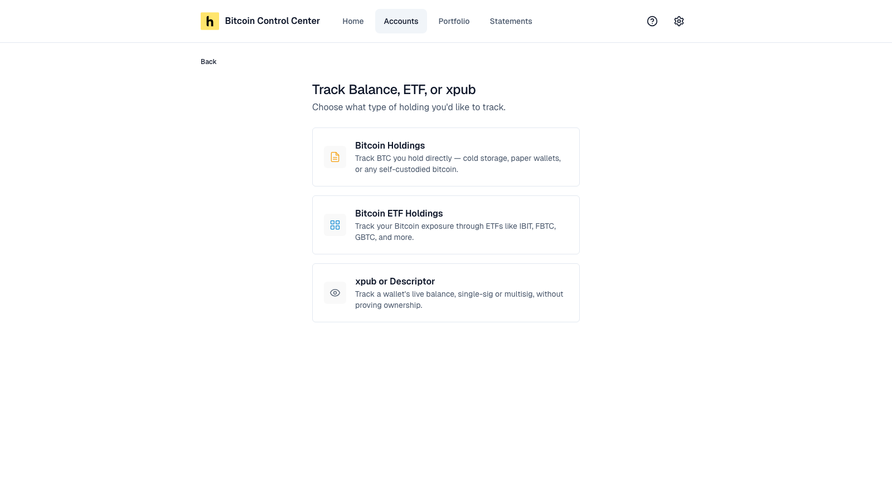
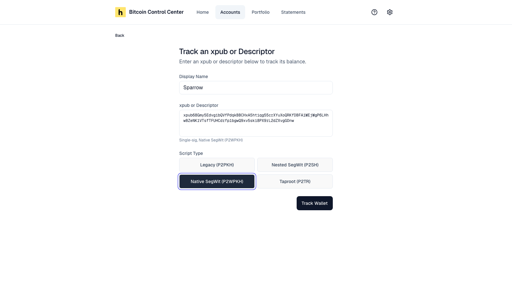
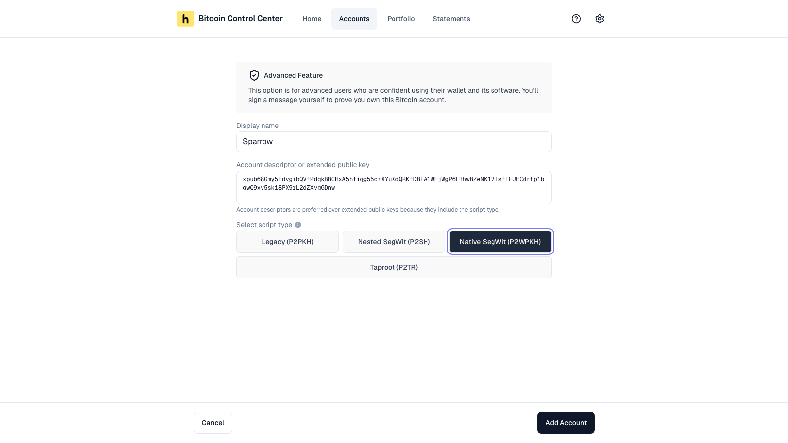

Use this for a wallet you can't connect directly. For example, a software wallet, a wallet the scan didn't find, or a wallet with no balance yet.

You have two choices:

| Choice | What it does | Works with | Can go on a statement |
| --- | --- | --- | --- |
| [**Track**](#track-a-wallet) | Watches the balance. You don't prove you own it. | Single-signature and multisig | No. It shows as **Unverified**. |
| [**Manually Sign**](#manually-sign-to-verify) | Watches the balance, and you sign a message to prove you own it. | Single-signature only | Yes, once verified |

Not sure where to find your xpub? See [Find your xpub](/bitcoin-control-center/wallet-guides/find-xpub) for Sparrow, BlueWallet, and Blockstream.

## Track a wallet

1. Select **Add Account** → **Track Balance, ETF, or xpub**.
2. Select **xpub or Descriptor**.

   <Frame caption="Track a wallet, a manual holding, or ETF shares.">
     
   </Frame>

3. Enter a **Display Name**.
4. Paste the **xpub or Descriptor**. Control Center shows what it found, such as "Single-sig, Native SegWit (P2WPKH)" or "Multisig, 2 of 3".
5. If you pasted a plain `xpub`, pick the **Script Type**.
6. Select **Track Wallet**.

<Frame caption="Paste an xpub or descriptor. Pick the script type for a plain xpub.">
  
</Frame>

You see **Wallet added**, and the account opens. There's no success screen for tracked wallets. Already in Control Center? You see **This wallet is already in Control Center**, and that account opens.

The wallet shows as **Unverified**. Its balance and history update like any other wallet. Statements leave it out.

### What you can track

| Input | Example start | Notes |
| --- | --- | --- |
| Single-signature descriptor | `wpkh(`, `sh(wpkh(`, `pkh(`, `tr(` | Includes the script type. You can paste the receive and change lines together. |
| Multisig descriptor | `wsh(sortedmulti(` | Key origins are optional. Exports with `Ypub` or `Zpub` keys, such as from Casa, work too. |
| `zpub` | `zpub6…` | Native SegWit |
| `ypub` | `ypub6…` | Nested SegWit |
| `xpub` | `xpub6…` | You pick the script type |

Control Center won't track a descriptor it would read as a different wallet. For example, a Taproot script path, a single address, or a branch other than receive and change. A single multisig cosigner's key, such as one `Zpub`, isn't a wallet on its own.

Already have this wallet in Control Center? You go to the existing account instead. If it was **pending**, it becomes **Unverified**, since you chose to track it.

To verify a tracked wallet later, see [Verify a tracked wallet later](/bitcoin-control-center/accounts/how-accounts-work#verify-a-tracked-wallet-later).

## Manually sign to verify

Use this to put a single-signature wallet on a statement when Control Center can't connect to it. You sign a message yourself in your wallet software.

1. Select **Add Account** → **Manually Sign**.
2. Enter a **Display name**.
3. Paste an **account descriptor or extended public key**.
4. If you pasted an `xpub`, pick the **script type**.
5. Select **Add Account**.

<Frame caption="Paste a descriptor or xpub. Pick the script type for an xpub.">
  
</Frame>

### What you can paste

| Input | Example start | Script type |
| --- | --- | --- |
| Descriptor (preferred) | `wpkh(`, `sh(wpkh(`, `pkh(`, `tr(` | Included |
| `zpub` | `zpub6…` | Native SegWit |
| `ypub` | `ypub6…` | Nested SegWit |
| `xpub` | `xpub6…` | You pick |

<Tip>Use a descriptor if you can. It includes the script type, so the balance is right the first time.</Tip>

### Which script type?

Match the start of your receive addresses.

| Your addresses start with | Pick |
| --- | --- |
| `1` | Legacy (P2PKH) |
| `3` | Nested SegWit (P2SH) |
| `bc1q` | Native SegWit (P2WPKH) |
| `bc1p` | Taproot (P2TR) |

A plain `xpub` starts on **Legacy (P2PKH)**. Change it if your addresses don't start with `1`.

Balance is zero after adding? You picked the wrong type. Going back adds a second account; it doesn't fix the first. Open the wrong account, select **Abandon**, and add the wallet again.

### Sign the message

1. Copy the **Address** and **Message**.
2. Sign the message with that address in your wallet software. See [Sign a message in your wallet](/bitcoin-control-center/wallet-guides/sign-message).
3. Paste the signature. Select **Verify**.

See [Verify ownership](/bitcoin-control-center/accounts/verify-ownership) for details.

## Limits

- **Manually Sign** is single-signature only. To verify a multisig wallet, see [Multisig](/bitcoin-control-center/accounts/multisig).
- Mainnet only on packaged apps.
- Never paste an `xprv` or a seed phrase. Control Center only needs public keys.

## Pasted a private key?

Control Center refuses extended private keys, such as `xprv`, `yprv`, `zprv`, or `tprv`. That includes a descriptor with one anywhere inside it.

| Where | What you see |
| --- | --- |
| **Track** | **Enter an xpub, or a single-sig or multisig descriptor** |
| **Manually Sign** | **Invalid input, please enter a valid xPub/yPub/zPub key** |
| **Multisig**, pasted descriptor | A message that starts **Invalid descriptor** |

Pasted a multisig descriptor into **Manually Sign**? You see the same **Invalid input** message. Use **Multisig** instead.

Export the wallet's public key or watch-only descriptor instead. See [Find your xpub](/bitcoin-control-center/wallet-guides/find-xpub).
