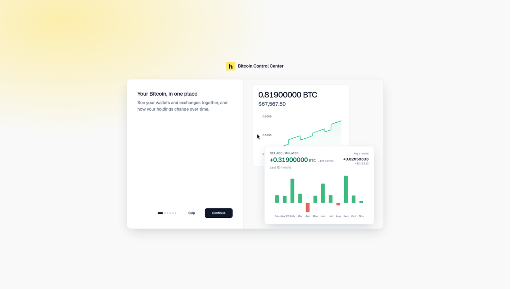
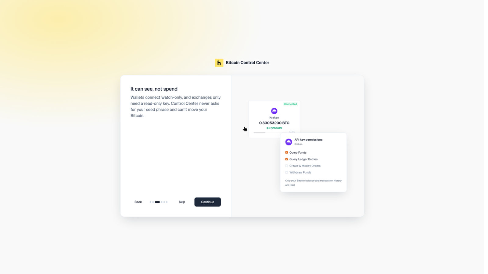
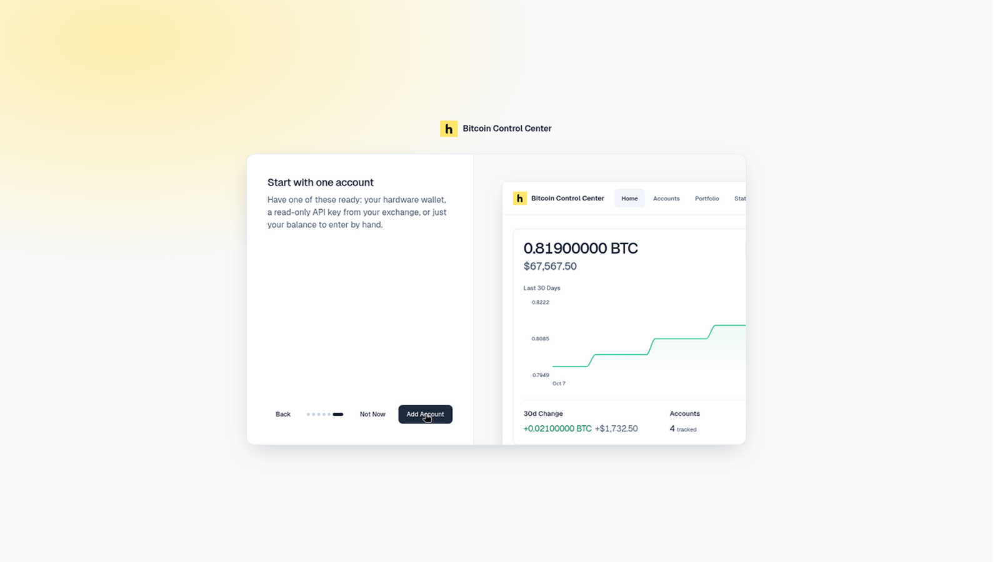
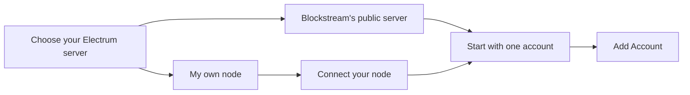
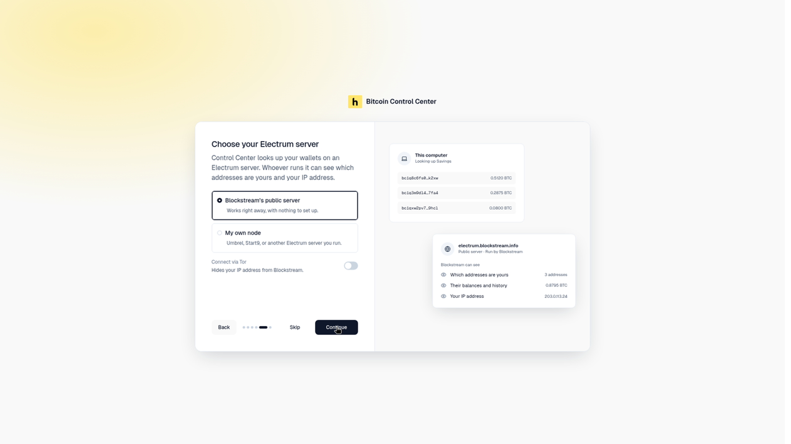
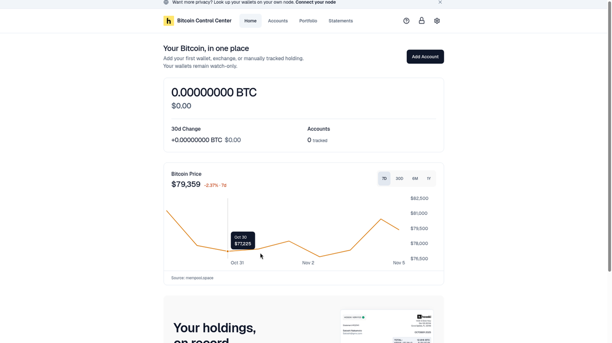
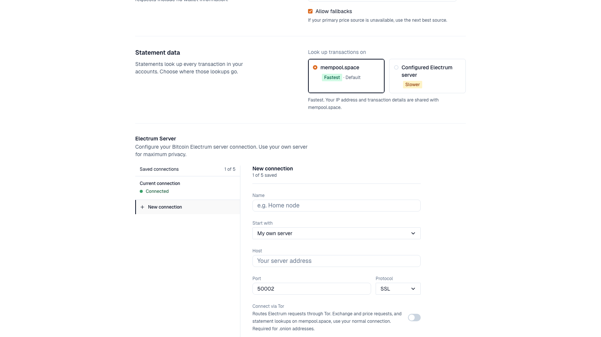
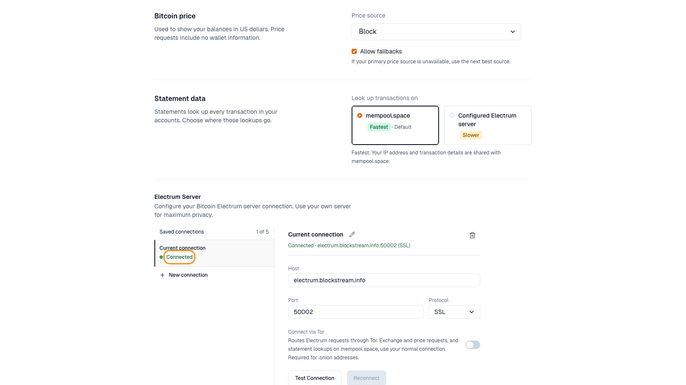
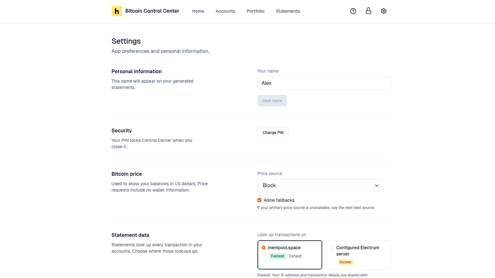

## 1. Set your PIN

Choose 6 digits, then enter them again. On **Your PIN is set**, select **Continue**. See [PIN and lock](/bitcoin-control-center/security/pin).

## 2. The introduction

A short introduction appears the first time. It shows sample data, not yours.

<Frame caption="The first-run introduction. Select Skip or Continue.">
  
</Frame>

<Frame caption="Wallets connect watch-only. Exchanges only need a read-only key.">
  
</Frame>

The steps are:

- **Your Bitcoin, in one place.**
- **Bring in what you already use.** Connect a hardware wallet, multisig, exchange, or enter holdings yourself.
- **It can see, not spend.** Wallets connect watch-only. Exchanges only need a read-only key.
- **Your data stays with you.** Your history is saved on this computer, or on your server.
- **Choose your Electrum server.** Desktop only. See [step 3](#3-choose-an-electrum-server-desktop).
- **Start with one account.** Have your hardware wallet, a read-only API key from your exchange, or just your balance to enter by hand.

<Frame caption="The last step takes you to Add Account.">
  
</Frame>

Select **Not Now** to look around first. The introduction does not come back after you finish or skip it.

## 3. Choose an Electrum server (desktop)

Control Center reads wallet balances from an **Electrum server**. Whoever runs it can see which addresses are yours and your IP address.

On desktop, the introduction asks before you add an account. StartOS always uses your own Electrs, so there is no server step.

Skipped the introduction? You stay on Blockstream's public server. To switch, see [Change it later](#change-it-later).

<Frame caption="Pick Blockstream's public server or your own node.">
  
</Frame>

### Blockstream's public server

It's selected to start. It works right away, with nothing to set up.

1. Optional: turn on **Connect via Tor** to hide your IP address from Blockstream. Tor can take a minute to start. Blockstream still sees your addresses.
2. Select **Continue**.

**"Couldn't connect through Tor."** Try again, or turn off **Connect via Tor**.

### My own node

1. Select **My own node**. Select **Continue**.
2. On **Connect your node**, enter the **Address**, such as `mynode.local` or `192.168.1.20`. Find it in your node's Electrum server app, such as Electrs or Fulcrum.
3. Check the **Port** and **Protocol**. SSL usually uses `50002`. TCP usually uses `50001`.
4. For a `.onion` address, turn on **Connect via Tor**.
5. Select **Connect**. When you see **Connected to your node.**, select **Continue**.

**"Couldn't connect to …"** Check the details and that your node is on. The reason shows under the message.

Your node is saved as **My node** in [Settings](/bitcoin-control-center/settings/app-settings#electrum-server-desktop). You can rename it there.

<Note>
  Choosing **Connect via Tor** or your own node here also sets **Statement data** to **Configured Electrum server**. Change it in [Settings](/bitcoin-control-center/settings/app-settings#statement-data-desktop).
</Note>

### While you use the public server

A strip above the header says **Want more privacy? Look up your wallets on your own node.** Select **Connect your node** to open Electrum settings. It goes away once you connect another server, or when you close it.

<Frame caption="The strip while you're on Blockstream's public server.">
  
</Frame>

### Change it later

1. Open **Settings** (gear icon, top right).
2. Under **Electrum Server**, select **New connection**.
3. Enter a **Name**, **Host**, **Port**, and **Protocol**.
4. Select **Test Connection**. Then select **Save & Connect**.

<Frame caption="Add a saved connection in Settings.">
  
</Frame>

- **Protocol:** use **SSL** for any server not on your own network. **TCP** is not encrypted.
- **Connect via Tor:** required for `.onion` addresses. Tor can take up to two minutes to start the first time.

<Frame caption="Connected.">
  
</Frame>

You can save up to 5 connections. Only one is active at a time. See [Settings](/bitcoin-control-center/settings/app-settings#electrum-server-desktop) for every option.

## 4. Add your name

Open **Settings**. Under **Personal information**, enter **Your name**. Select **Save name**. It pre-fills the name on new [statements](/bitcoin-control-center/statements/statements-and-hoseki-verified).

<Frame caption="Your name on statements.">
  
</Frame>

## 5. Add your first account

Select **Add Account** on **Home**. Start with [How accounts work](/bitcoin-control-center/accounts/how-accounts-work).
