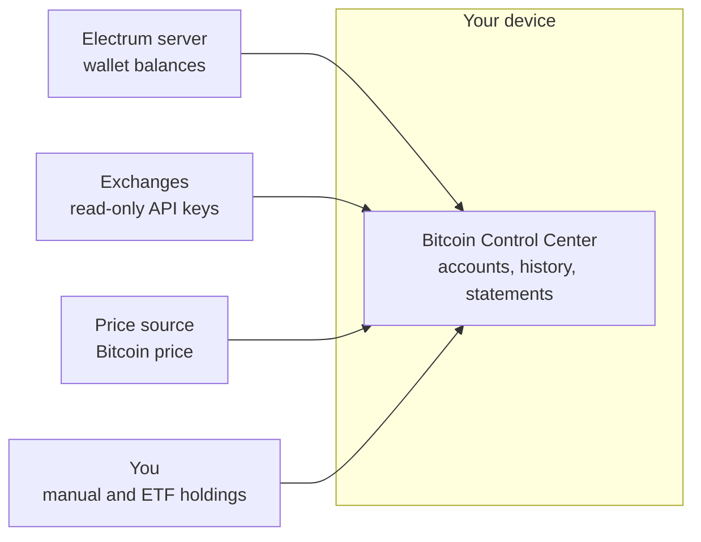

Bitcoin Control Center tracks your Bitcoin savings on your own device. It is watch-only. It never holds your seed or private keys.

<Info>**No Hoseki account needed.** Control Center is separate from [Hoseki Prove](/prove). Your data stays on your device and is never sent to Hoseki.</Info>

<Columns cols={2}>
  <Card title="Quickstart" icon="rocket" href="/bitcoin-control-center/quickstart">
    Install, connect, add an account.
  </Card>

  <Card title="How accounts work" icon="wallet" href="/bitcoin-control-center/accounts/how-accounts-work">
    Wallets, exchanges, manual holdings.
  </Card>

  <Card title="Statements" icon="file-circle-check" href="/bitcoin-control-center/statements/statements-and-hoseki-verified">
    Create a statement of your holdings.
  </Card>

  <Card title="Troubleshooting" icon="life-ring" href="/bitcoin-control-center/help/troubleshooting">
    Fix common problems.
  </Card>
</Columns>

## How it works

Control Center runs on your computer or home server. It reads your balances from the sources you choose and keeps everything it learns on your device.

- **Wallets** are read from an Electrum server, using public keys only.
- **Exchanges** are read with a read-only API key you create.
- **Manual and ETF holdings** are numbers you type in.
- **Prices** come from a price source you pick in [Settings](/bitcoin-control-center/settings/app-settings).

Nothing is sent to Hoseki. See [Privacy and security](/bitcoin-control-center/privacy-security) for exactly what leaves your device.

## New here?

<Steps>
  <Step title="Install">
    Pick [Mac or Windows](/bitcoin-control-center/getting-started/install-desktop), [StartOS](/bitcoin-control-center/getting-started/install-startos), or [Umbrel](/bitcoin-control-center/getting-started/install-umbrel).
  </Step>
  <Step title="Set up">
    Set your PIN and choose an Electrum server. See [First run](/bitcoin-control-center/getting-started/first-run).
  </Step>
  <Step title="Look around">
    Learn what each page does in the [tour](/bitcoin-control-center/getting-started/tour).
  </Step>
</Steps>
