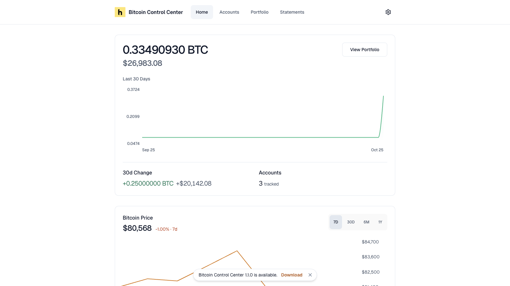

| Platform | How to update |
| --- | --- |
| Mac / Windows | Download the new installer. Install over the old app. |
| StartOS | Update it from **Marketplace**. StartOS shows when the Community Registry has a new version. |
| Umbrel | Coming soon. Email [support@hoseki.app](mailto:support@hoseki.app) for help. See [Install on Umbrel](/bitcoin-control-center/getting-started/install-umbrel). |

In-place updates keep your data. [Back up](/bitcoin-control-center/maintenance/backup-restore) first anyway.

<Note>Sideloaded Control Center on StartOS before it was in the registry? Install it from the [Community Registry](/bitcoin-control-center/getting-started/install-startos) to get updates in **Marketplace**.</Note>

## Updating from an older version

### Updating to 1.4.0

There's nothing to do. Your PIN, accounts, settings, and statements carry over.

- If you have accounts, finished the introduction, or connected a server, you won't see the new Electrum server step. To change servers, see [Change it later](/bitcoin-control-center/getting-started/first-run#change-it-later).
- On Blockstream's public server, you may see a new strip that says **Want more privacy?** Connect your node, or close it.
- If an earlier import saved a private key, updating replaces it with the matching public key.

### Updating to 1.1.0

Updating to 1.1.0 from 1.0 or earlier adds a PIN. You must set one before you can use the app.

- On StartOS, a critical task says **Set a PIN before using Bitcoin Control Center**. Run **Set PIN**.
- On Mac and Windows, the app shows **Set up your PIN** the first time you open it.

Accounts, settings, and statements carry over. See [PIN and lock](/bitcoin-control-center/security/pin).

## Desktop update notice

The desktop app checks for a new version at launch and about once a day. When one exists, a notice appears at the bottom of the window.

<Frame caption="The update notice.">
  
</Frame>

- **Download** opens [bitcoincontrolcenter.com](https://www.bitcoincontrolcenter.com) in your browser.
- **×** hides it until you restart the app or a newer version comes out.

The app does not update itself.

## Update the desktop app

1. Quit fully. Use **Quit** in the tray menu, not just the window's close button.
2. Run the new installer.
3. Open the app. Enter your PIN.

<Note>A statement that is generating when the app quits will fail. Generate it again after the update.</Note>
