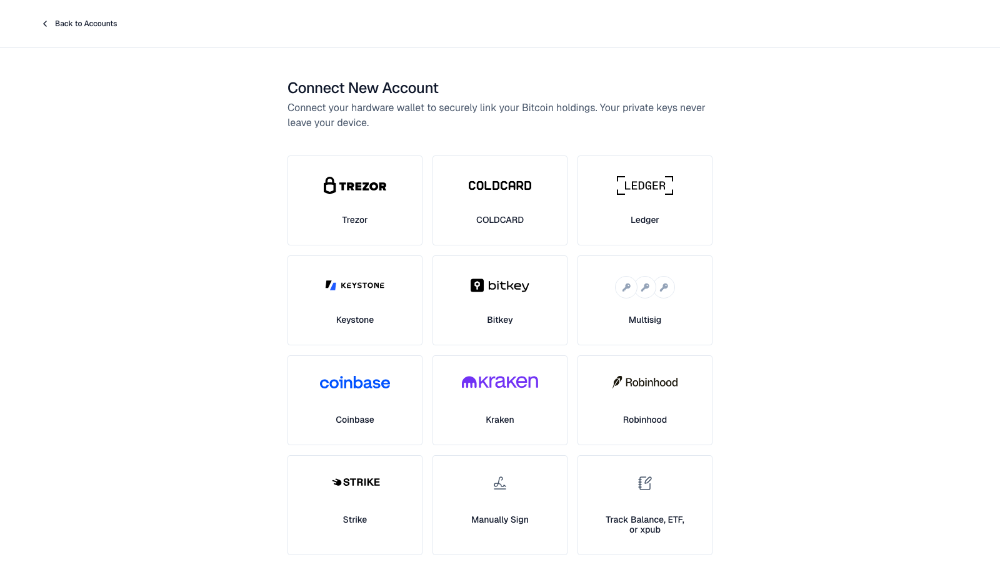

<Steps>
  <Step title="Install">
    Pick [desktop](/bitcoin-control-center/getting-started/install-desktop), [StartOS](/bitcoin-control-center/getting-started/install-startos) from the Community Registry, or [Umbrel](/bitcoin-control-center/getting-started/install-umbrel).
  </Step>
  <Step title="Set your PIN">
    Choose a 6-digit PIN. You enter it each time you open Control Center. See [PIN and lock](/bitcoin-control-center/security/pin).
  </Step>
  <Step title="Choose an Electrum server">
    On desktop, the introduction asks: **Blockstream's public server** or **My own node**. Your own is best for privacy. See [First run](/bitcoin-control-center/getting-started/first-run#3-choose-an-electrum-server-desktop).

    StartOS and Umbrel use your own node automatically.
  </Step>
  <Step title="Add an account">
    Select **Add Account**. Pick a [wallet](/bitcoin-control-center/accounts/hardware-wallets), an [exchange](/bitcoin-control-center/accounts/exchanges), or **Track Balance, ETF, or xpub** for a [manual holding](/bitcoin-control-center/accounts/manual-and-etfs) or a [wallet you only want to watch](/bitcoin-control-center/accounts/xpub-and-descriptors#track-a-wallet).

    <Frame caption="Pick an account type.">
      
    </Frame>
  </Step>
  <Step title="Prove control (wallets only)">
    Sign one message on your hardware wallet. This marks the wallet **verified** so it can go on a [statement](/bitcoin-control-center/statements/statements-and-hoseki-verified). See [Verify ownership](/bitcoin-control-center/accounts/verify-ownership). Skip this for wallets you only track.
  </Step>
  <Step title="Back up">
    Set up [backups](/bitcoin-control-center/maintenance/backup-restore) before you rely on it.
  </Step>
</Steps>

<Warning>
  Never enter a seed phrase or private key. Control Center never asks for one.
</Warning>
