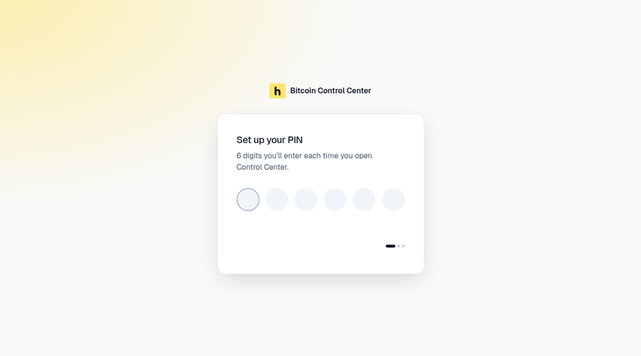
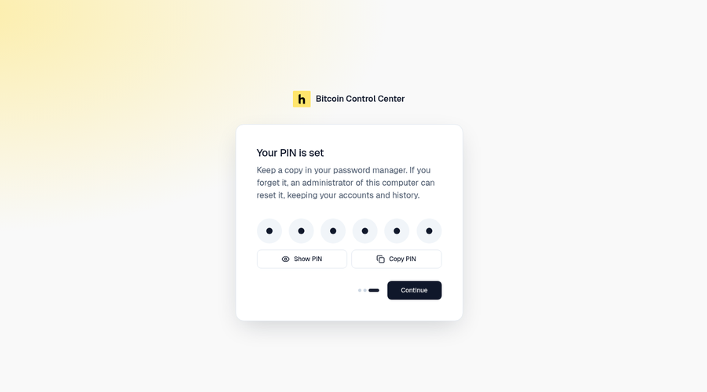
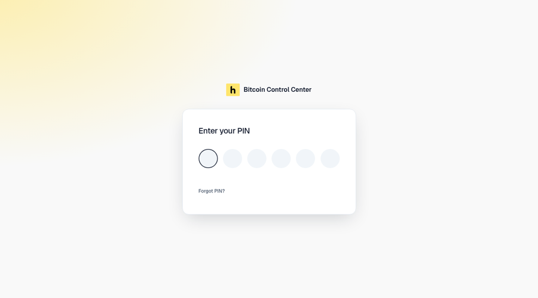

Control Center uses a **6-digit PIN** on desktop and StartOS. It stops anyone else on your computer or network from opening it.

## Set your PIN

| Platform | Where |
| --- | --- |
| Mac and Windows | The app asks on first launch. |
| StartOS | In StartOS: **Actions** → **Set PIN**. |

<Frame caption="Enter 6 digits, then enter them again.">
  
</Frame>

On Mac and Windows:

1. On **Set up your PIN**, enter 6 digits.
2. On **Confirm your PIN**, enter them again. Select **Back** to start over.
3. On **Your PIN is set**, select **Show PIN** or **Copy PIN** to save it in your password manager.
4. Select **Continue**.

<Frame caption="Your PIN is set. Show or copy it before you continue.">
  
</Frame>

On StartOS, the app shows **Set your PIN in StartOS** until you run the action.

## Unlock

Enter your PIN each time you open Control Center.

<Frame caption="Enter your PIN.">
  
</Frame>

**Wrong PIN?** You get 5 tries. After that, you wait 30 seconds. Each further wrong try doubles the wait, up to 1 hour.

## When the app locks

- You select the **padlock** icon at the top right.
- You close the desktop window.
- You reopen a closed tab, or duplicate a tab.
- The app or server restarts. Everyone is signed out.

Reloading the page does not lock it. There is no idle timeout.

## Change your PIN

Open **Settings** → **Security** → **Change PIN**.

1. **Enter your current PIN.**
2. **Choose a new PIN.**
3. **Confirm your new PIN.**

Select **Back** to go back a step. Other tabs and browsers are signed out.

On StartOS, **Sign out everywhere** signs out every browser at once.

## Forgot your PIN?

Select **Forgot PIN?** on the sign-in screen. Your accounts and history are kept on every platform.

<Tabs>
  <Tab title="Mac and Windows">
    1. Select **Reset PIN**.
    2. Enter your computer's administrator password when asked.
    3. You see **PIN reset. Restarting Control Center…**
    4. On **Choose a new PIN**, set a new PIN.

    Cancelled the password prompt? You see **PIN not reset. Nothing changed.**

    Not an administrator on this computer? Ask one to enter their password.

    Quit before you set a new PIN? Next time you see **Set up your PIN**. Your accounts and history are still there.
  </Tab>
  <Tab title="StartOS">
    1. Open StartOS. Go to Bitcoin Control Center.
    2. Select **Actions** → **Set PIN**. Enter a new PIN.
    3. Come back. Enter the new PIN.
  </Tab>
</Tabs>

Umbrel support is coming soon. Questions? Email [support@hoseki.app](mailto:support@hoseki.app).
