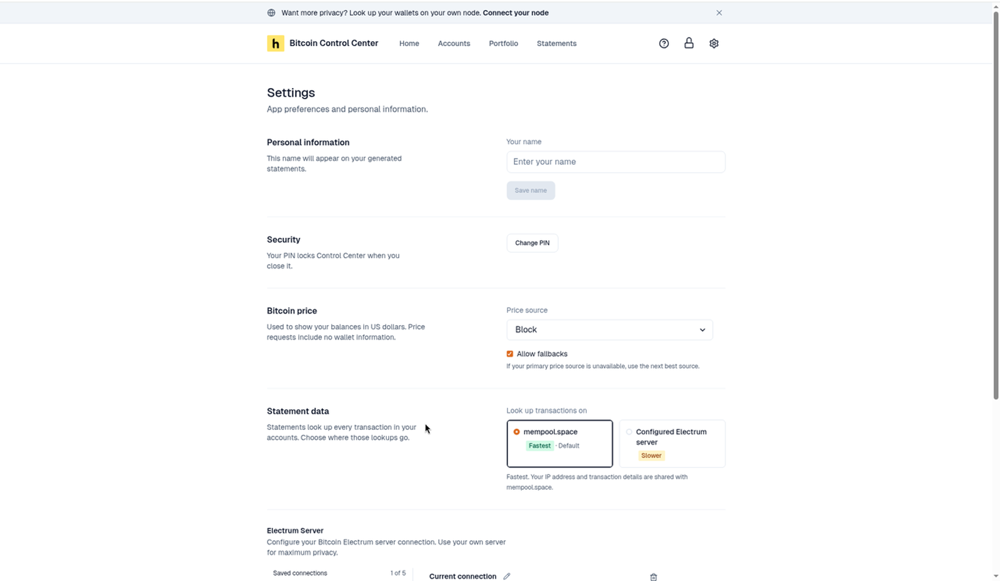
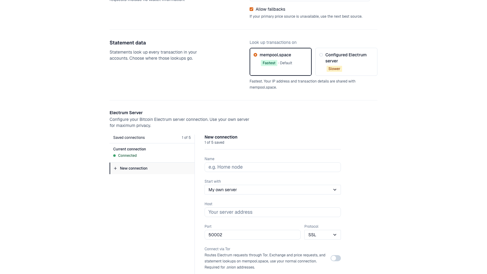
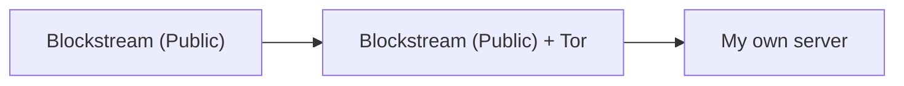

Open **Settings** with the gear icon at the top right. Changes save as you make them, unless a section has its own **Save** button.

<Frame caption="Settings on desktop.">
  
</Frame>

| Section | Desktop | StartOS |
| --- | --- | --- |
| Personal information | Yes | Yes |
| Security | Yes | Yes |
| Bitcoin price | Yes | Yes |
| Statement data | Yes | No. Uses your Mempool. |
| Electrum Server | Yes | No. Uses your Electrs. |

## Personal information

**Your name** fills in the name on new statements. Select **Save name**.

## Security

**Change PIN** and, on servers, **Sign out everywhere**. See [PIN and lock](/bitcoin-control-center/security/pin).

## Bitcoin price

Sets where the Bitcoin price comes from. Price requests include no wallet information.

| Option | Notes |
| --- | --- |
| **Your mempool server** (with its address) | Only on StartOS. Most private. The default there. |
| **Block** | The default on desktop. |
| **mempool.space** | Public. |
| **Coinbase** | Public. |
| **CoinGecko** | Public. |

**Allow fallbacks** (on by default) uses the next source in the list if yours is down.

| You see | Meaning |
| --- | --- |
| **Using … while … is unavailable.** | Your source is down. A fallback is in use. |
| **No price source is available right now. Showing the last known price.** | No source answered. Prices may be out of date. |
| **No price is available right now.** | No source answered, and there's no saved price yet. Turn on **Allow fallbacks**, or pick another source. |

## Statement data (desktop)

Choose where statement transaction lookups go.

| Option | Speed | Who sees the lookups |
| --- | --- | --- |
| **mempool.space** (default) | Fastest | mempool.space sees your IP address and transactions. |
| **Configured Electrum server** | Slower | Your Electrum server operator. Your IP stays hidden if you use Tor. |

Choosing **Connect via Tor** or your own node in the [introduction](/bitcoin-control-center/getting-started/first-run#3-choose-an-electrum-server-desktop) starts you on **Configured Electrum server**.

Existing statements keep the source they were made with.

## Electrum Server (desktop)

Where wallet balances come from. Use your own server for the most privacy.

<Frame caption="Saved connections on the left. Details on the right.">
  
</Frame>

- **Saved connections:** up to 5. One is active. It shows **Connected**, **Connecting…**, **Checking…**, or **Disconnected**. Others show **Tor** or **Direct**.
- **New connection:** enter **Name**, **Host**, **Port**, and **Protocol**. **Start with** can fill in **Blockstream (Public)**.
- **Test Connection** checks it without switching. **Save** keeps it for later. **Save & Connect** saves and switches to it.
- To edit a saved connection, change its details. Then select **Save & Reconnect** (in use) or **Save & Connect** (not in use).
- **Connect via Tor** sends Electrum requests through Tor. It's required for `.onion` addresses. Exchange and price requests, and statement lookups on mempool.space, do not use Tor.
- **Delete** a connection with the trash icon. You can't delete the active one. Connect to another first.
- **Limit reached. Delete one to add another.** You have 5 saved. Delete one first.
- **Connection saved. Select Connect when you want to use it.** You saved without switching. Select **Connect** to use it.
- **This connection changed in another window.** Reload the page, then save again.

A node you connected in the introduction is listed as **My node**.

The server you started with is listed as **Current connection**, even after you switch. Rename it with the pencil icon.

Your accounts and history are kept when you switch servers.

### Why Blockstream by default?

Control Center needs an Electrum server to read your balances. Out of the box, it uses **Blockstream (Public)**. The [introduction](/bitcoin-control-center/getting-started/first-run#3-choose-an-electrum-server-desktop) asks whether to keep it or connect your own node.

Wallet makers like Trezor and Ledger run their own servers, but only for their own apps. Other apps can't use them.

**What Blockstream can see:** the addresses you check and your IP address. It can't see your keys or move your bitcoin.

**More privacy:**

1. Turn on **Connect via Tor**. It works with **Blockstream (Public)**. Syncing is slower, but the server can't see your IP. Exchange and price requests still use your normal connection.
2. Choose **My own server** to keep everything on your own node.

With Tor, Blockstream still sees which addresses you check and can tell they were checked together (likely the same wallet), but it can't tie them to your IP. Only **My own server** avoids that.

Least private to most private.

### Tor messages

| Message | Meaning |
| --- | --- |
| **Starting Tor… n%** | Tor is starting. It can take up to two minutes. **Test Connection** and **Connect** wait until it's ready. |
| **Tor could not connect within two minutes. Check your network.** | Check your internet. Then select **Test Connection** to try Tor again. |
| **Tor ready** | Connected through Tor. |
| **Onion addresses need Tor** | Turn on **Connect via Tor**. |
| **This connection needs Tor** | You tried to turn Tor off for a `.onion` address. Select **Keep Tor on**. |
| **Connect without Tor?** | You turned Tor off. The server will see your IP address. |
| **Bundled Tor is missing** | Reinstall the desktop app. |
| **Tor could not start.**, **Tor stopped unexpectedly.**, or **Tor did not open its local proxy.** | Quit fully and reopen the app. Still failing? Reinstall it, or turn off **Connect via Tor**. |

## What's not in Settings

- **Currency:** Home and Portfolio show USD. Pick CAD, GBP, or EUR per [statement](/bitcoin-control-center/statements/statements-and-hoseki-verified).
- **Dark mode:** not available yet.
- **Backup and restore:** done outside the app. See [Backup and restore](/bitcoin-control-center/maintenance/backup-restore).
- **App version:** not shown in the app yet. See [Find your app version](/contact#find-your-app-version).
