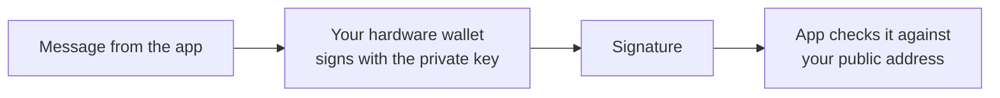

Hoseki's products only ever use **public** information about your wallet. Here is what each piece is, and what's safe to share.

| Item | What it does | Share it? |
| --- | --- | --- |
| **Seed phrase** (12 or 24 words) | Backs up your whole wallet. Anyone with it can spend everything. | **Never.** Not with Hoseki, support, or any website. |
| **Private key** | Spends Bitcoin and signs messages. Lives on your hardware wallet. | **Never.** It stays on your device. |
| **xpub** (or ypub, zpub) | Lets an app find all your wallet's addresses and balances. It can't spend. | Only with apps you trust. It reveals your addresses. |
| **Address** | Where Bitcoin is received. Public on the blockchain. | Yes, when you need to. |
| **Signed message** | Proves you control an address. | Yes. That's its purpose. |

## Watch-only

An app with only your xpub is **watch-only**. It can see, but it can't spend. Both [Bitcoin Control Center](/bitcoin-control-center) and [Hoseki Prove](/prove) are watch-only.

## Signing a message

To prove you control a wallet, you sign a short message with its private key. Your hardware wallet does the signing. The key never leaves the device.

Signing a message is **not** a transaction:

- Nothing is sent to the Bitcoin network.
- No fees are paid.
- No Bitcoin moves.
- The private key is not revealed.

<Warning>Always read what your device asks you to approve. A real ownership message is a sentence of text. If your device shows an amount and a destination address, that's a transaction. Reject it.</Warning>

## Find your xpub or sign in your wallet app

Step-by-step guides for Sparrow, BlueWallet, Blockstream (Jade), and Nunchuk:

- [Find your xpub](/bitcoin-control-center/wallet-guides/find-xpub)
- [Sign a message in your wallet](/bitcoin-control-center/wallet-guides/sign-message)
- [Export a multisig wallet](/bitcoin-control-center/wallet-guides/export-multisig)
