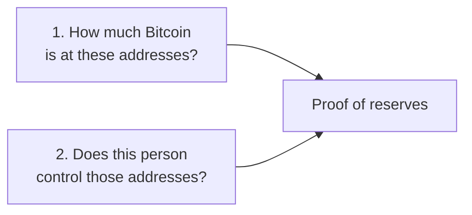

**Proof of reserves** shows that someone holds the Bitcoin they say they hold. It's checked against the Bitcoin blockchain, not taken on trust.

Companies use it to show customers their deposits are backed. Individuals use it to show a lender, advisor, accountant, or buyer that they really hold their Bitcoin.

## Two parts: the balance and the keys

A complete proof answers two questions.

1. **The balance.** Anyone can look up a Bitcoin address on the public blockchain. So the balance is easy to check.
2. **Control.** A balance alone proves nothing. Anyone can copy someone else's address. The holder proves control by **signing a message** with the wallet's private key. Hoseki calls this **proof of control**.

<Info>Signing a message is not a transaction. It doesn't move Bitcoin, and it doesn't reveal the private key. See [Keys, xpubs, and signing](/learn/keys-xpubs-and-signing).</Info>

## How Hoseki does it

1. You connect a wallet using its **public** key. The app finds the wallet's addresses and balances.
2. You sign a short message with the wallet's key, on your own device.
3. The app checks the signature against the wallet's address.
4. Wallets that pass are marked verified. Statements of verified wallets carry the **Hoseki Verified** badge.

Both products work this way:

| | [Bitcoin Control Center](/bitcoin-control-center) | [Hoseki Prove](/prove) |
| --- | --- | --- |
| Where the proof is made | On your own device | On Hoseki's servers |
| Statement | PDF you download | PDF you download, or sent to a partner who requested it |
| Ongoing sharing with a partner | No | Yes |

## What proof of reserves doesn't show

- **Debts.** It shows Bitcoin held, not what is owed against it.
- **Sole control.** It shows you can sign. It can't rule out that someone else also holds a copy of the keys.
- **The future.** It shows control when you signed, and balances for the period on the statement. Funds can move later.
- **Other holdings.** Exchange balances and manual entries aren't proven this way. Statements cover verified self-custody wallets only.

## Proof of reserves for companies

Hoseki also tracks public companies and funds that hold Bitcoin. See the [proof of reserves board](https://www.hoseki.app/proof-of-reserves) on hoseki.app.
