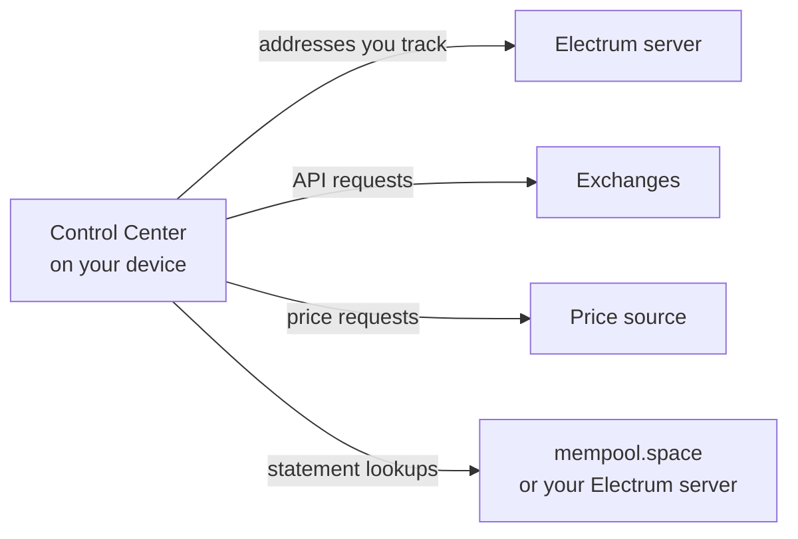

## Stays on your device

- Accounts, balances, history, settings, and statements.
- Exchange API keys, encrypted with a key stored next to your data.
- Your PIN, stored as a one-way hash.

No Hoseki account. No telemetry. Hoseki cannot see your data.

## Leaves your device

| Who | What they see | How to limit it |
| --- | --- | --- |
| Your Electrum server | The addresses you track, and your IP address | Use your own server. Use Tor for remote servers. |
| Exchanges | Requests made with your API key | Use read-only keys. |
| Price source | Price requests, no wallet data | Use your own Mempool on StartOS or Umbrel. |
| mempool.space (desktop statements) | Your IP address and the transactions on your statement | Set **Statement data** to **Configured Electrum server**. |
| bitcoincontrolcenter.com (desktop) | Your IP address, once a day. No app or wallet data. | — |

<Warning>
  The desktop app starts on **Blockstream's public Electrum server**. Blockstream can see the addresses you track until you switch. See [First run](/getting-started/first-run#3-choose-an-electrum-server-desktop).
</Warning>

## Most private setup

1. Run your own node with an Electrum server.
2. On desktop, connect to it. Use its `.onion` address with **Connect via Tor** when you're away from home.
3. Set **Statement data** to **Configured Electrum server**.
4. On StartOS or Umbrel, use **Your mempool server** as the price source.

## Stay safe

- Never enter a seed phrase or private key. Control Center only needs public keys.
- Use read-only exchange API keys.
- Set a PIN you don't use elsewhere. See [PIN and lock](/security/pin).
- Delete wallet export and descriptor files after you use them.
- Remove xpubs, addresses, and keys from logs before you share them.
- Report security issues privately. See [SECURITY.md](https://github.com/hoseki-inc/bitcoin-control-center/blob/main/SECURITY.md).
