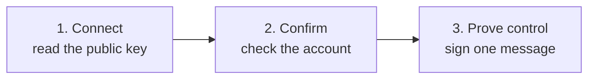

## What you need

| Wallet | Connects by | You also need | Address types |
| --- | --- | --- | --- |
| **Trezor** | Trezor Suite | Trezor Suite desktop or web. Pop-ups allowed. | Legacy, Nested SegWit, Native SegWit. No Taproot. |
| **Ledger** | USB | The **Bitcoin** app open. Chrome, Brave, or Edge. | Legacy, Nested SegWit, Native SegWit, Taproot |
| **COLDCARD** | MicroSD file | A MicroSD card. USB is not supported. | Legacy, Nested SegWit, Native SegWit |

Using Keystone, BitBox, Passport, Jade, or another wallet? Use [manual signing](/prove/claims/manual-signing).

## Add a hardware wallet

Open **Claims**. Pick your wallet. Each one follows the same path:

<Tabs>
  <Tab title="Trezor">
    1. Connect and unlock your Trezor. Select **Next**.
    2. Trezor Suite opens. Allow Hoseki to read your device details.
    3. Select **Next**. Choose the account in Trezor Suite. Come back to Prove.
    4. Check the account. Select **Yes, Continue**.
    5. Select **Prove Control**. Approve the message on your Trezor.

    - Allow pop-ups for prove.hoseki.app.
    - If asked, allow local network access so Prove can find Trezor Suite desktop.
    - Taproot accounts can't be used. Trezor can't sign messages for them.
  </Tab>
  <Tab title="Ledger">
    1. Connect by USB. Unlock with your PIN. Open the **Bitcoin** app.
    2. Select **Next**. Allow the browser prompt to connect.
    3. Prove scans for accounts. Pick one. Select **Yes, Continue**.
    4. Select **Prove Control**. Approve the message on your Ledger.

    - Close Ledger Live and other wallet apps first.
    - Only accounts with a balance appear. "No wallets found" means none have a balance.
  </Tab>
  <Tab title="COLDCARD">
    1. Pick your model: **MK2/MK3**, **MK4**, or **Q**. Choose **By Airgapping**.
    2. On the COLDCARD, go to **Advanced/Tools** → **Export Wallet** → **Generic JSON**. Choose your account number (usually `0`).
    3. Upload `coldcard-export.json`. Pick the account.
    4. Download `hoseki-ownership-claim.txt`. Copy it to the MicroSD card. Don't edit it.
    5. On the COLDCARD, go to **Advanced/Tools** → **File Management** → **Sign Text File**. Pick the file.
    6. Upload `hoseki-ownership-claim-signed.txt`. Select **Prove Control**.

    <Tip>Delete the export files from your computer when you finish.</Tip>
  </Tab>
</Tabs>

## If it gets stuck

- **Waiting for device confirmation:** check the device screen. After 20 seconds, select the reset link and try again.
- **Ledger errors:** "Locked device" means unlock it. "Wrong app open" or "Bitcoin app not open" means open the Bitcoin app.
- **Trezor Suite window closed:** select **Next** again.

<Warning>Never type your seed phrase into Prove or any website. Approve signatures on the device only.</Warning>
