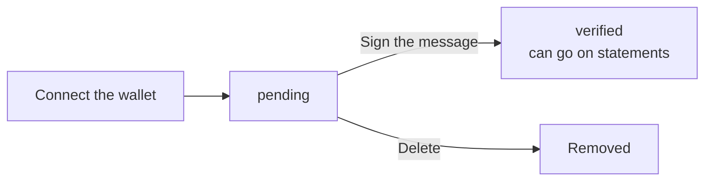

A **claim** is a wallet you've proven you control. Each claim has a name you choose and a system name, such as **Account #1**.

## Ways to add a claim

Open **Claims** and pick one:

| Option | Use it for | Guide |
| --- | --- | --- |
| **Trezor** | Trezor wallets, through Trezor Suite | [Hardware wallets](/prove/claims/hardware-wallets) |
| **Ledger** | Ledger wallets, over USB | [Hardware wallets](/prove/claims/hardware-wallets) |
| **COLDCARD** | COLDCARD, with a MicroSD card | [Hardware wallets](/prove/claims/hardware-wallets) |
| **Multisig** | Multisig wallets, signed with your keys | [Multisig](/prove/claims/multisig) |
| **Verify with Manual Signing** (Advanced) | Any other single-signature wallet | [Manual signing](/prove/claims/manual-signing) |

## Verifying a claim



You prove control by signing this message with the wallet's **first receive address**:

```text
I, you@example.com, affirm sole control of this account. No other third-party claims/access permitted. Ownership revocable solely by me. ID=…
```

Your email goes where `you@example.com` is. The ID is unique to the claim.

<Info>Signing a message is not a transaction. It can't move your Bitcoin. It doesn't reveal your private keys.</Info>

When it works, you see **Claim Verified!**

## Statuses

| Status | Meaning |
| --- | --- |
| **pending** | Connected, not yet signed. Open it and select **Continue**. |
| **verified** | Signed. It can go on statements and be shared. |

## Limits to know

- **10 claims per account.** Pending claims count too. Email [support@hoseki.app](mailto:support@hoseki.app) to raise your limit.
- **One owner per wallet.** If someone already verified a wallet with Hoseki, you can't claim it again. Contact support if this looks wrong.
- **Bitcoin mainnet only.**
- **Empty wallets:** Ledger and COLDCARD scans only list accounts with a balance. Use [manual signing](/prove/claims/manual-signing) for an empty wallet.

Next: [manage your claims](/prove/claims/manage-claims).
