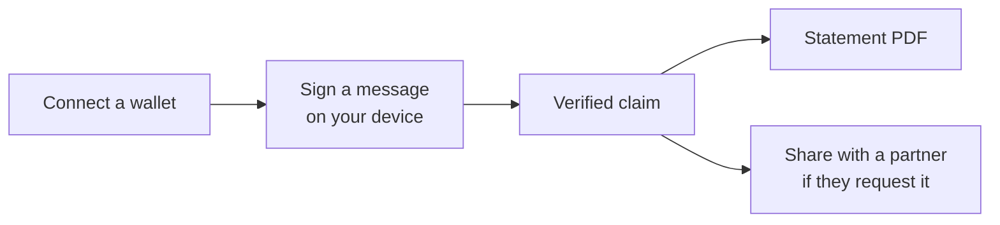

[Hoseki Prove](https://prove.hoseki.app) lets you prove you control your self-custodied Bitcoin without moving it. You get a PDF statement of your holdings, like a bank statement for your own wallets.

## How it works

1. **Connect a wallet.** Prove reads its public key. It never sees your private keys or seed phrase.
2. **Sign a message.** Your hardware wallet signs a short message. This proves you control the wallet. It does not move funds.
3. **Get a verified claim.** A claim is a wallet you've proven you control.
4. **Create a statement.** Pick claims and a date range. Download a PDF.

A partner, such as a lender or advisor, can also ask you for a statement or for ongoing access. You approve or reject each request.

<Columns cols={2}>
  <Card title="Get started" icon="rocket" href="/prove/getting-started">
    Sign in and add your first claim.
  </Card>
  <Card title="Claims" icon="wallet" href="/prove/claims/how-claims-work">
    Connect and verify wallets.
  </Card>
  <Card title="Statements" icon="file-circle-check" href="/prove/statements">
    Create and download statements.
  </Card>
  <Card title="Requests and sharing" icon="share-nodes" href="/prove/requests-and-sharing">
    Respond to partner requests.
  </Card>
</Columns>

## Prove or Bitcoin Control Center?

| | Prove | [Bitcoin Control Center](/bitcoin-control-center) |
| --- | --- | --- |
| Runs | In your browser at prove.hoseki.app | On your computer or home server |
| Account | Hoseki account (email sign-in) | None |
| Data stored | On Hoseki's servers | Only on your device |
| Partner requests and sharing | Yes | No |
| Exchanges and manual holdings | No | Yes |
| Cost | Credits per statement | Free and open source |

Pick Prove when someone needs a statement from you. Pick Control Center to track your savings privately.
