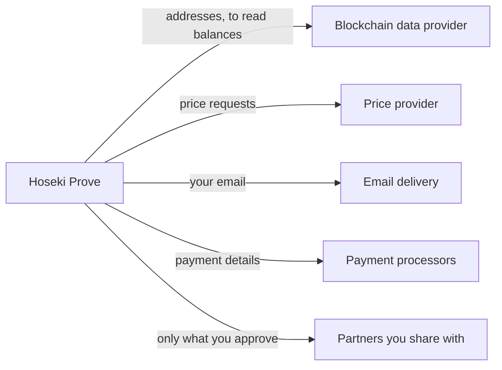

## What Prove can and can't do

- **Can't spend.** Prove only ever has public keys. It never has your private keys or seed phrase.
- **Can see balances.** With your public keys, Prove can see your wallets' addresses, balances, and transactions.

## What Hoseki stores

| Data | Why |
| --- | --- |
| Your email | Sign-in, and printed on your statements |
| Public keys (xpubs) and descriptors | To find your balances and transactions |
| Claim names, device types, and derivation paths | To show and re-check your claims |
| Signed messages | Proof that you control each wallet |
| Statement settings, name, and address | To rebuild your statements when you download them |
| Credit purchases | Billing and receipts |

Statement PDFs are not stored. Prove builds a fresh copy each time you download.

## Who else sees data

- **Partners** see only what you approve: claim names, balances, and history. Never your addresses or keys.
- **Service providers** handle blockchain data, prices, email, payments, and app analytics for Hoseki. See the [Privacy Policy](https://www.hoseki.app/privacy-policy).

## Stay safe

- Never enter a seed phrase or private key. Hoseki will never ask for one.
- Never share your sign-in code.
- Delete wallet export and descriptor files after you use them.
- Remember that your xpub reveals all your addresses. Share it only with apps you trust.

## Delete your data

Email [support@hoseki.app](mailto:support@hoseki.app) from your account's email to delete a verified claim or your whole account. You can delete pending claims yourself. See [Manage claims](/prove/claims/manage-claims).
