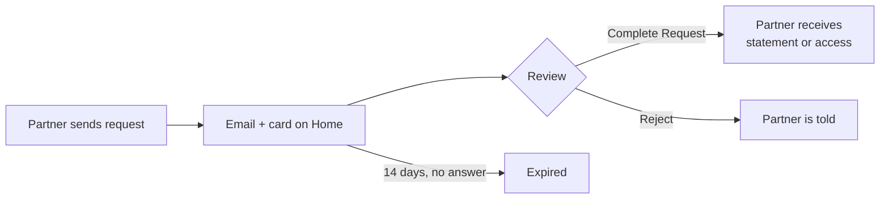

A **partner**, such as a lender, advisor, or exchange, can ask you to prove your Bitcoin through Hoseki. You decide whether to accept.

## Two kinds of request

| | Statement request | Sharing request |
| --- | --- | --- |
| What they get | One statement for dates they choose | Ongoing access to your claims' balances and history |
| How long | One time | Until you or they disconnect |
| Cost to you | Free | Free |

**Partners never get** your wallet addresses or private keys. They do see each shared claim's name and balance.

## How you get a request

You get an email: **New Access Request for Hoseki**. Select **Review Request**, then sign in. Pending requests appear on **Home** and under **Requests**.

Requests expire after **14 days**.

<Warning>Sign in with the **same email** the request was sent to. Otherwise you see "This access request requires you to login with the email address shown above."</Warning>

## Complete a statement request

1. Open the request. Check the name, email, and dates. The partner sets the dates.
2. Pick the claims to include. No verified claims yet? Select **Connect Wallet** first.
3. Select **Preview Statement** to check it.
4. Select **Complete Request**. You see **Statement Sent!**

## Complete a sharing request

1. Open the request. Read what will and won't be shared.
2. Pick the claims to share. Claims you already share with that partner are already checked.
3. Select **Complete Request**.

## Reject a request

Select **Reject** → **Yes, Reject**. The partner is told you declined.

## Stop sharing

1. Open **Sharing**. Find the partner. Select **Edit**.
2. Select **Disconnect** next to a claim. Confirm.

The partner keeps data it already received, but gets no new updates.

## Questions about a request

Contact the partner. Their support email is in the request email. For problems with Prove itself, email [support@hoseki.app](mailto:support@hoseki.app).
